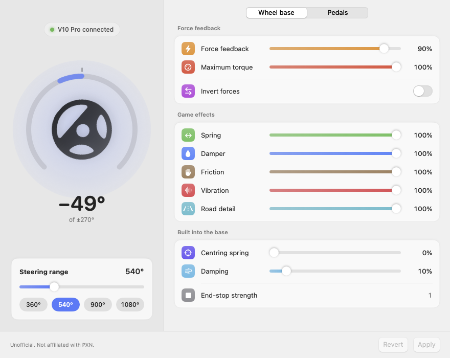
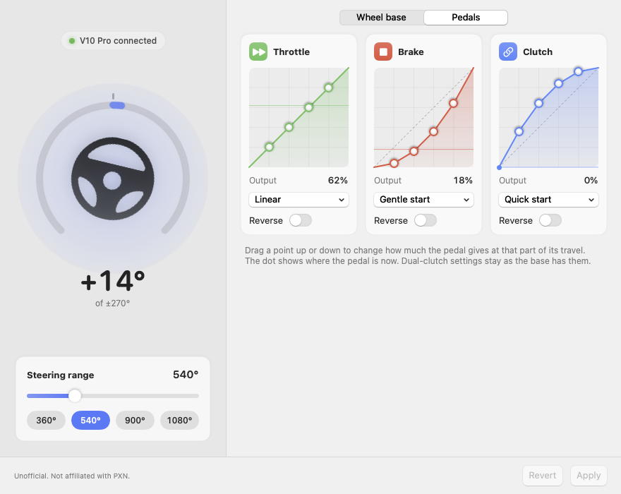

# PXN V10 Pro Tuner for Mac

Set up a **PXN V10 Pro** direct drive wheel base from a Mac: its steering range, its force feedback and its
pedal curves. PXN's own settings software runs on Windows only; this does that job on macOS.

<picture>
  <source media="(prefers-color-scheme: dark)" srcset="docs/connected-dark.png">
  
</picture>

<picture>
  <source media="(prefers-color-scheme: dark)" srcset="docs/pedals-dark.png">
  
</picture>

## What it does

- **Steering range.** Any range from 90° to 1800°, with one-tap presets, and the wheel shown turning live.
- **Force feedback.** Overall strength, maximum torque, and the direction of the forces.
- **Game effects.** How strongly the base plays a game's spring, damper, friction and vibration effects, and
  how much road detail it lets through.
- **The base's own feel.** Its built-in centring spring and damping.
- **Pedal curves.** A response curve for the throttle, the brake and the clutch: drag four points or pick a
  ready-made shape, and watch each pedal move along its curve.
- **Nothing changes until you say so.** The app shows the base's own settings, you edit a copy, and
  **Apply** sends it. What you then see is the base's answer.
- **A command-line tool** with the same settings, for scripts.

**Unofficial.** This project is not affiliated with, endorsed by or supported by PXN. Use it at your own risk.

## Requirements

- **macOS 13 (Ventura) or later.**
- **Any Mac.** The app is built for both Apple silicon and Intel. It has been tested on Apple silicon only.
- **A PXN V10 Pro wheel base**, powered on, in PC mode, and plugged into the Mac by USB. No other wheel base
  is recognised.

## Install

There are two ways. Downloading is quicker; building needs no trust in a file from the internet.

### Option 1: download the app

1. Open the [latest release](https://github.com/NEXSTEAD-GAMES/pxn-v10-pro-tuner-mac/releases/latest) and download `PXN-V10-Pro-Tuner-….zip`.
2. Double-click the downloaded file. A folder named **PXN V10 Pro Tuner** and a version number appears
   beside it.
3. Drag **PXN V10 Pro Tuner** from that folder into your Applications folder.
4. Open it. macOS refuses the first time, saying it could not verify the app: the app is not notarised by
   Apple. Close that message.
5. Open **System Settings**, then **Privacy & Security**, and scroll down to **Security**. Next to the note
   that the app was blocked, press **Open Anyway**, and confirm with your password or Touch ID.
6. Open the app again. From now on it opens like any other app.

If you are at home in Terminal, this one command does the same as steps 4 to 6:

```sh
xattr -dr com.apple.quarantine "/Applications/PXN V10 Pro Tuner.app"
```

The downloaded folder also holds `pxntuner`, the same settings from Terminal. macOS blocks it in the same
way; `xattr -d com.apple.quarantine pxntuner` in that folder clears it.

### Option 2: build it yourself

It takes about ten minutes the first time and needs no programming. An app you build yourself opens
normally, with no warning.

1. **Install Apple's command-line tools.** Open the Terminal app and run:

   ```sh
   xcode-select --install
   ```

   Press **Install** in the window that appears and wait for it to finish. If it says the tools are already
   installed, carry on.

2. **Get this project.** Download [the source as a ZIP](https://github.com/NEXSTEAD-GAMES/pxn-v10-pro-tuner-mac/archive/refs/heads/main.zip) and unzip it.

3. **Go to the project's folder in Terminal.** Type `cd` and a space, drag the unzipped folder onto the
   Terminal window, and press Return.

4. **Build the app.**

   ```sh
   ./Scripts/make-app.sh
   ```

   It is done when it prints `built build/PXN V10 Pro Tuner.app and build/pxntuner`.

5. **Put the app in Applications.**

   ```sh
   open build
   ```

   A Finder window opens. Drag **PXN V10 Pro Tuner** into your Applications folder, then open it like any
   other app.

### Updating and removing

To update, install the newer version over the old one, by either route.

To remove it, drag the app to the Bin. It keeps nothing on your Mac: the settings live in the wheel base.

## First run

1. Make sure the base is powered, in PC mode and plugged in.
2. Open **PXN V10 Pro Tuner**. Within a second or two the label at the top left turns green and reads
   **V10 Pro connected**, and the sliders show the base's own settings.
3. Turn the wheel. The wheel in the window turns with it.
4. Move a slider. **Not applied yet** appears at the bottom.
5. Press **Apply**. The base takes the new settings, and the window shows what the base reports back.
   **Revert** drops your edits instead.
6. Switch to **Pedals** at the top for the pedal curves. Press a pedal and its dot moves along its curve.

**If it stays on "Not connected"**

- Check the base has power and is in PC mode. In a console mode the Mac sees a different device.
- Plug the USB cable straight into the Mac, not through a hub, and try another port.
- Quit and reopen the app.

## The settings and their ranges

| Setting | Range |
|---|---|
| Steering range | 90° to 1800°, in 10° steps |
| Force feedback strength | 0 to 100% |
| Maximum torque | 30 to 100% |
| Game effects: spring, damper, friction, vibration, road detail | 0 to 100% each |
| Built into the base: centring spring, damping | 0 to 100% each |
| Invert forces | on or off |

The ranges are the ones PXN's software allows. The app reads the base's settings when it connects, lets you
edit a copy, and sends it when you press **Apply**. What it then shows is the base's own answer, not what was
asked for.

### Pedals

The **Pedals** page has a response curve for the throttle, the brake and the clutch. Each curve has four
points, at 20, 40, 60 and 80 percent of the pedal's travel; drag a point up or down to set how much the pedal
gives there, or pick a ready-made shape (linear, gentle start, quick start, S-curve). A dot on the curve
shows where the pedal is right now. Each pedal can also be reversed.

## What it does not do

- **Button mapping.** PXN's software has it; this app does not yet.
- **Dual clutch.** The base's dual-clutch values are kept exactly as they are.
- **End-stop strength.** It is shown as the base reports it and never changed.
- **Firmware updates.** Deliberately left out.
- **Force feedback in games.** macOS has no force feedback driver for wheels. A game has to drive the base
  itself; this app only changes how the base responds.
- **Other wheel bases.** Only the V10 Pro (USB ID `36E6:400B`) is recognised.

## Tested on

One PXN V10 Pro (USB device version `0x010B`) with its pedal set plugged into the base, in PC mode, on an
Apple silicon Mac (M3 Pro) running macOS 27. Nothing else: not an Intel Mac, and not an older macOS.

## For developers

Needs Swift 5.9 or later.

```sh
swift test
```

runs the packet tests, which need no hardware. `./Scripts/make-app.sh` builds the app and the command-line
tool for Apple silicon and Intel, signed ad hoc. `./Scripts/make-release.sh` then packs them into the zip a
release carries. The version number is the one line in `VERSION`.

## Command line

The build also makes `build/pxntuner`, the same settings from Terminal:

```sh
build/pxntuner get
build/pxntuner set range=540 damper=40
```

`get` prints every setting with its short name. `set` changes the ones you name, leaves the rest as the base
has them, and prints what the base reports afterwards.

```sh
build/pxntuner pedals
build/pxntuner pedals brake=gentle clutch=10,30,60,85 throttle-reverse=0
```

`pedals` on its own prints the three curves. A curve is a shape's name (`linear`, `gentle`, `quick`, `smooth`)
or four rising output percentages, for 20, 40, 60 and 80 percent of the pedal's travel.

## How it talks to the base

The base has three USB HID interfaces. Settings travel on its vendor interface (usage page `0xFF00`), in
HID report 1, zero padded to 63 bytes. One packet layout serves both directions.

| Bytes | Meaning |
|---|---|
| 0-3 | `01 81 E0 22` to ask for the settings (the base's answer starts the same way), `01 41 E0 22` to set them |
| 4-5 | Steering range in degrees, little-endian |
| 6 | Force feedback strength |
| 7 | Spring |
| 8 | Damper |
| 9 | Vibration (sine) |
| 10 | Inertia. PXN's software always writes 100 |
| 11 | Maximum torque |
| 13 | Centring spring |
| 14 | Damping |
| 15 | Road detail |
| 17 | Invert forces |
| 18 | End-stop strength |
| 34 | Friction |

The other bytes up to 34 are reported by the base but not named or written by PXN's software, which sends
zero for them. The base keeps its own values there.

The pedal settings are a second packet on the same report: `01 81 E0 23` asks for them, `01 41 E0 23` sets
them.

| Bytes | Meaning |
|---|---|
| 4-19 | Throttle curve: four points, each a travel and an output, 16 bits each, little-endian, 0 to 65535 |
| 20-35 | Brake curve, the same way |
| 36-51 | Clutch curve, the same way |
| 52-53 | Dual-clutch mode and value |
| 54-56 | Throttle, brake and clutch reversed (0 or 1) |

This was worked out by studying how PXN's Windows software talks to the base, then confirmed against a real
V10 Pro. Never send these packets to the base's joystick interface: there, report 1 is a force feedback
command.

## Layout

- `Sources/WheelProtocol`: the packet, with no hardware access.
- `Sources/WheelLink`: the USB connection (IOKit HID).
- `Sources/TunerUI`: the window and its model (SwiftUI).
- `Sources/TunerApp`: the app around that window.
- `Sources/pxntuner`: the command-line tool.
- `Sources/TunerPreview`: draws the window with sample settings into PNG files, with no wheel connected.
  `swift run TunerPreview docs` remakes the pictures in `docs/`.

## Licence

MIT. See [LICENSE](LICENSE).
